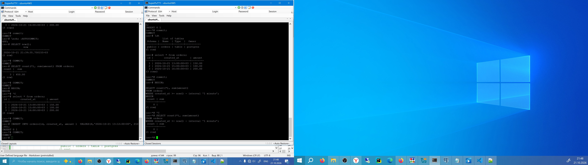
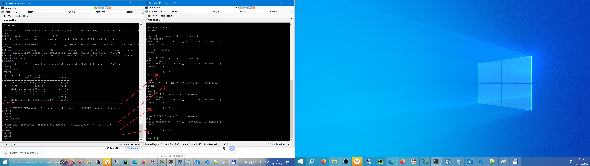
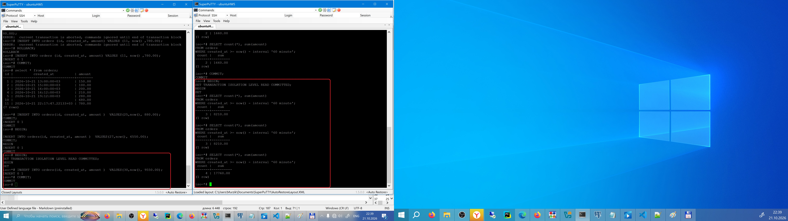

Изоляция транзакций: отчёт по заказам

Цель:
обосновать выбор уровня изоляции PostgreSQL для согласованного построения отчётов при параллельной записи данных;


Описание/Пошаговая инструкция выполнения домашнего задания:
Контекст

В системе заказов один процесс непрерывно записывает новые заказы, второй строит минутный финансовый отчёт; в отчёте периодически «прыгают» суммы и количество заказов при повторном запуске;


Пошаговая инструкция

Откройте 2 сессии psql к PostgreSQL 17 и отключите autocommit;
- выполнено
Создайте таблицу orders(id serial, created_at timestamptz, amount numeric) и вставьте 2–3 записи;
- выполнено
Read committed: 
в сессии 2 начните транзакцию и выполните select count(*), sum(amount) ... за последнюю минуту; 
-вып
в сессии 1 вставьте новый заказ и выполните commit;
-вып
в сессии 2 повторите тот же select и зафиксируйте изменение; завершите транзакции;
-вып
Repeatable read: 
повторите сценарий, но обе транзакции начните с set transaction isolation level repeatable read;
- вып
в сессии 2 начните транзакцию и выполните select count(*), sum(amount) ... за последнюю минуту; 
- вып
в сессии 1 вставьте новый заказ и выполните commit;
- вып
 сравните результаты внутри транзакции и после её завершения;
В отчёте укажите, где и почему меняются значения, и какой уровень изоляции нужен для отчёта;


```sql

CREATE DATABASE iso;
\c iso
    iso=# \echo :AUTOCOMMIT
        on
		    iso=# \set AUTOCOMMIT OFF
                iso=# \echo :AUTOCOMMIT
                    OFF
				       iso=# CREATE TABLE orders(id serial, created_at timestamptz, amount numeric);
                           CREATE TABLE
						   COMMIT;
						   iso=# \dt
                                          List of tables
                            Schema |  Name  | Type  |  Owner
                           --------+--------+-------+----------
                            public | orders | table | postgres
                           (1 row)


						       INSERT INTO orders(id, created_at, amount )  VALUES(1,'2026-10-21 10:00:00+00', 150.00);
							   COMMIT;
							   INSERT INTO orders(id, created_at, amount )  VALUES(2,'2026-10-21 12:00:00+00', 100.00);
							   							   COMMIT;
							   INSERT INTO orders(id, created_at, amount )  VALUES(3,'2026-10-21 13:00:00+00', 200.00);
							   							   COMMIT;
							   iso=# select * from orders;
                                        id |       created_at       | amount
                                       ----+------------------------+--------
                                         1 | 2026-10-21 13:00:00+03 | 150.00
                                         2 | 2026-10-21 15:00:00+03 | 100.00
                                         3 | 2026-10-21 16:00:00+03 | 200.00
                                       (3 rows)
							#Так, идем другим путем
							DROP TABLE orders;
```
```sql
iso=# \dt
Did not find any tables.
iso=# BEGIN;
BEGIN
iso=*# CREATE TABLE orders(id serial, created_at timestamptz, amount numeric);
CREATE TABLE
iso=*# INSERT INTO orders(id, created_at, amount )  VALUES(1,'2026-10-21 10:00:00+00', 150.00);
INSERT 0 1
iso=*# INSERT INTO orders(id, created_at, amount )  VALUES(2,'2026-10-21 12:00:00+00', 100.00);
INSERT 0 1
iso=*# INSERT INTO orders(id, created_at, amount )  VALUES(3,'2026-10-21 13:00:00+00', 200.00);
INSERT 0 1
iso=*# commit;
COMMIT
iso=# \dt
           List of tables
 Schema |  Name  | Type  |  Owner
--------+--------+-------+----------
 public | orders | table | postgres
(1 row)

iso=# select * from orders;
 id |       created_at       | amount
----+------------------------+--------
  1 | 2026-10-21 13:00:00+03 | 150.00
  2 | 2026-10-21 15:00:00+03 | 100.00
  3 | 2026-10-21 16:00:00+03 | 200.00
(3 rows)

iso=*# commit;

INSERT INTO orders(id, created_at, amount )  VALUES(4,'2026-10-21 13:12:00+00', 210.00);

iso=# BEGIN;

SELECT count(*), sum(amount)
FROM orders
WHERE created_at >= now() - interval '1 minute';
BEGIN
 count | sum
-------+-----
     0 |
(1 row)

iso=*# ^C
iso=*# SELECT count(*), sum(amount)
FROM orders
WHERE created_at >= now() - interval '1 minute';
 count | sum
-------+-----
     0 |
(1 row)
iso=# show transaction isolation level;
 transaction_isolation
-----------------------
 read committed
(1 row)


```


```sh
#Окна 1 и 2
iso=# BEGIN;
SET TRANSACTION ISOLATION LEVEL REPEATABLE READ;
BEGIN
SET
iso=*# show transaction isolation level;
 transaction_isolation
-----------------------
 repeatable read
(1 row)

iso=*#

# ОКно 2
SELECT count(*), sum(amount)
FROM orders
WHERE created_at >= now() - interval '1 minute';


#Окно 1
INSERT INTO orders(id, created_at, amount )  VALUES(25,now(), 880.00);
COMMIT;


BEGIN;

INSERT INTO orders(id, created_at, amount )  VALUES(27,now(), 6550.00);
COMMIT;
```

# Repeatable Read транзакция видит данные в том состоянии, в котором они находились на момент первого запроса в этой транзакции


```sh
iso=# BEGIN;
SET TRANSACTION ISOLATION LEVEL READ COMMITTED;
BEGIN
SET
iso=*# SELECT count(*), sum(amount)
FROM orders
WHERE created_at >= now() - interval '60 minute';
 count |   sum
-------+---------
     3 | 8210.00
(1 row)

iso=*# SELECT count(*), sum(amount)
FROM orders
WHERE created_at >= now() - interval '60 minute';
 count |   sum
-------+---------
     3 | 8210.00
(1 row)

iso=*# SELECT count(*), sum(amount)
FROM orders
WHERE created_at >= now() - interval '60 minute';
 count |   sum
-------+----------
     4 | 17760.00
(1 row)

iso=*#


#Окно 1

iso=# BEGIN;
SET TRANSACTION ISOLATION LEVEL READ COMMITTED;
BEGIN
SET
iso=*# INSERT INTO orders(id, created_at, amount )  VALUES(30,now(), 9550.00);
INSERT 0 1
iso=*# COMMIT;
COMMIT
iso=#


```


# При первом выполнении не понял смысл сделал по инструкции, переделал Read committed - после commit в первом окне, изменения видны в открытой сессии второго окна
# Repeatable Read осле commit в первом окне, изменения не видны в открытой сессии второй